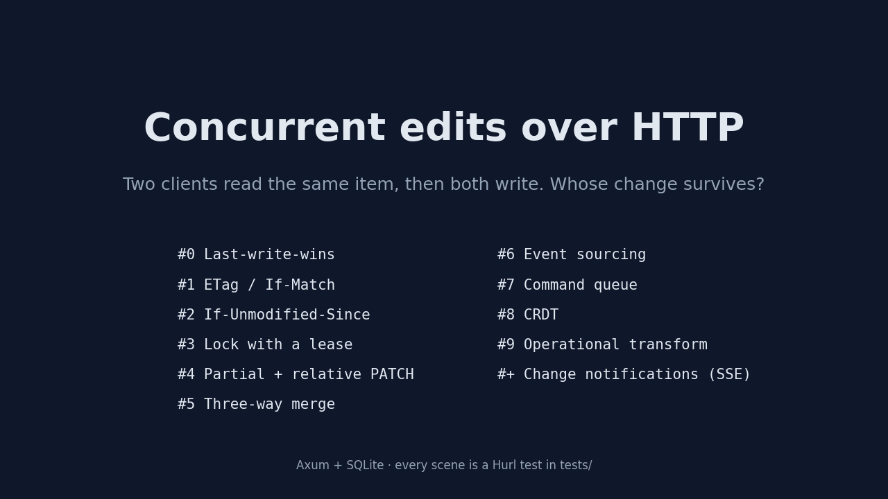
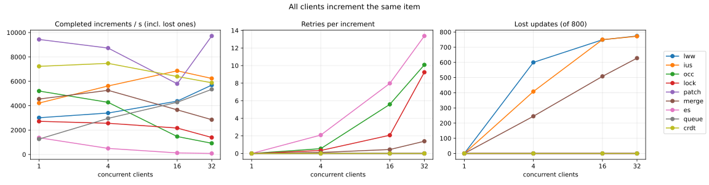

# Concurrent edits over HTTP

Axum + SQLite playground comparing strategies for concurrent writes to one resource.



The same animation as video: [docs/explainer.mp4](docs/explainer.mp4). Regenerate both with `python3 docs/explainer.py`
(needs matplotlib and Pillow; the MP4 also needs ffmpeg).

| # | Strategy | Endpoint | Conflict |
|---|---|---|---|
| 0 | Last-write-wins | `PUT /lww/items/{id}` | none (lost update) |
| 1 | ETag / If-Match | `PUT /occ/items/{id}` | `428` no header, `412` stale |
| 2 | If-Unmodified-Since | `PUT /ius/items/{id}` | `428` / `412`, but blind within the same second |
| 3 | Lock lease | `POST\|DELETE /lock/items/{id}/lock?ttl_secs=N`, `PUT /lock/items/{id}` + `Lock-Token` | `423` |
| 4 | Partial / relative | `PATCH /patch/items/{id}` `{name?, qty?, qty_inc?, expected_version?}` | `409` only if guarded |
| 5 | Three-way merge | `PUT /merge/items/{id}` `{base_version, name, qty}` | auto-merge, else `409` + per-field conflicts |
| 6 | Event sourcing | `POST /es/streams/{id}/events` `{expected_version, type, data}`, `GET /es/streams/{id}` | `409` + `current_version` |
| 7 | Command queue | `POST /queue/items/{id}/commands` → `202` + `Location`, `GET /commands/{id}` | command `failed` |
| 8 | CRDT (PN-counter + LWW register) | `POST /crdt/{key}` `{replica, p, n, name?: {value, ts}}`, `GET /crdt/{key}` | never: merges converge |
| 9 | Operational transform (text) | `POST /ot/docs`, `POST /ot/docs/{id}/ops` `{base_version, op}`, `GET /ot/docs/{id}` | never: op is rewritten |
| + | Change notifications (SSE) | `GET /items/{id}/events?limit=N` | prevents conflicts: clients see new versions |

Shared: `POST /items`, `GET /items/{id}` (returns `ETag` and `Last-Modified`).
Every item version is recorded in `item_history` by a trigger; #2 and #5 read it.

```sh
cargo run                 # DATABASE_URL=sqlite:app.db ADDR=127.0.0.1:3000 by default
./run-tests.sh            # fresh DB + all tests/*.hurl
```

Each `.hurl` file replays the A/B interleaving step by step, so tests are deterministic.

Latest run: 11 files, 94 requests, all passing.

## Benchmark

```sh
python3 bench/bench.py    # builds release, fresh DB, writes bench/results.json + bench/bench.svg
```

Worst case contention: N concurrent clients each do a logical `+1` on the **same** item,
800 increments per run, using each strategy's natural client loop (read → write, retry on
`412`/`409`/`423`). Lost updates = 800 − the final count.



At 32 clients (10-core macOS machine, release build, Python stdlib client):

| Strategy | Increments/s | Retries per increment | Lost updates |
|---|---:|---:|---:|
| lww | 5688 | 0 | **774 / 800** |
| ius | 6234 | 0 | **772 / 800** |
| occ | 918 | 10.1 | 0 |
| lock | 1392 | 9.2 | 0 |
| patch | 9718 | 0 | 0 |
| merge | 2851 | 1.4 | **628 / 800** |
| es | 82 | 13.4 | 0 |
| queue | 5342 | 0 | 0 |
| crdt | 5880 | 0 | 0 |

OT (#9) and SSE (+) are not in the benchmark: OT edits text, not a counter, and SSE doesn't write.

Takeaways:
- **lww** looks fast only because it throws work away: 97% of increments vanish.
- **ius** is just as bad under load: every write lands in the same second, so the 1 s timestamp never detects anything. Fine for human-speed edits, useless for fast concurrent writers.
- **merge** loses increments by design: two clients that both turn qty 10 into 11 made "the same change" as far as a three-way merge can tell (git does the same). Good for documents with independent fields, wrong for counters.
- **patch** wins whenever the change can be expressed as a relative/field update: the DB serializes it, no retries.
- **crdt** is close behind and needs no coordination at all: replicas can even be offline and sync later.
- **occ** is cheapest at low contention, but retries grow with the number of writers on one row.
- **lock** degrades more gently than occ under heavy contention, at the cost of 3 extra round-trips per write.
- **queue** has no conflicts; clients get `202` and wait for the result.
- **es** is slowest here because each retry re-reads the whole stream (no snapshot/projection) and every writer races for the same next version.

Caveats: a single hot row is the worst case. With writes spread over many items, conflicts and
retries mostly disappear. The Python client (GIL, one connection per thread) caps absolute numbers,
and single runs are noisy (±30%): compare the shapes of the curves, not exact values.
